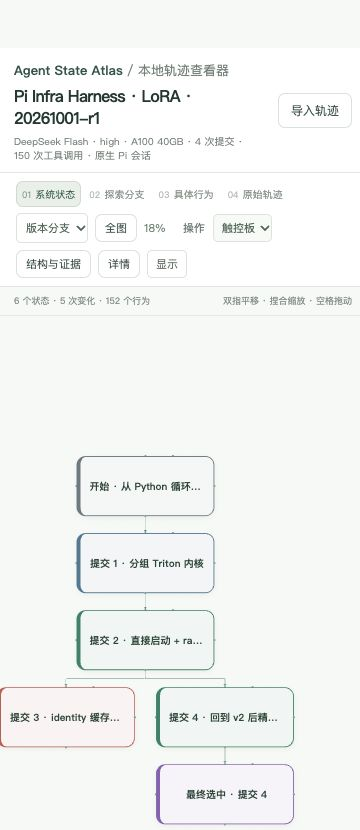

# TraceVista

**把 coding agent 的日志变成可以逐层放大的状态与执行地图。**

缩小时看系统状态和版本分叉；放大后依次看到探索方向、具体行为、原始 trajectory。
点击卡片，右侧展示描述、内部行为、代码来源、时间关系、测量和原始证据。

本仓库包含受 ThoughtDAG 启发、基于 React Flow 开发的独立可视化引擎、`tracevista-skill` 转换 skill，
以及一份完整导出的 **Pi Infra Harness / LoRA / 20261001-r1** 真实轨迹。
工具面向不同 coding agent 和任务，任务描述及证据保存在导出数据中。

## 1. 克隆并打开示例

需要 **Node.js 24.x、pnpm 11.19.0**。转换新的日志或跑 skill 测试还需要 **Python ≥ 3.10**。
可以直接使用云端查看器 **https://tracevista.pages.dev/** 并导入文件；也可以按下面步骤本地运行。

```bash
git clone https://github.com/Superone77/trajactory_visualizer.git
cd trajactory_visualizer

# 如果尚未安装 pnpm（Node 安装包一般附带 npm）
npm install -g pnpm@11.19.0

pnpm install --frozen-lockfile --ignore-scripts
pnpm dev
```

打开：

- **Pi 真实轨迹：** http://127.0.0.1:8875/?example=pi-infra-r1
- 首页 / 本地 JSON 导入：http://127.0.0.1:8875/

首页也有示例入口。首次加载先显示状态卡片；点击“全图”查看完整版本树。
`trajectory.html` 保留为兼容入口。若 8875 被占用，先停止占用它的开发服务器，或手动用
`pnpm exec vite --config viewer/vite.config.ts --host 127.0.0.1 --port 8876 --strictPort` 更换端口。

## 2. 怎么读图

| 层级 / 操作 | 看到什么 |
|---|---|
| 系统状态 | 代码或产物状态；绿色 / 红色表示同口径测量值改善 / 退化，紫色表示引用历史结果的最终选择 |
| 工作阶段 | 一个状态下提出或尝试的方向，执行先后可在时间线中查看 |
| 具体行为 | Explore、Plan、Edit、Execute、Verify、Diagnose；执行者身份独立于行为类型 |
| 原始轨迹 | 原始思考、发言、工具输入和返回；长正文可在卡片内滚动 |
| 点击卡片 | 右侧详情、版本来源、内部行为、原始证据及跳转 |
| “版本分支 / 执行顺序” | 分别查看代码来自哪个版本，以及实际先后顺序 |
| “结构与证据” | 全任务搜索与筛选：探索、Skill、review、经验读写、TODO、测量和独立结论 |

触控板默认双指平移、捏合缩放；鼠标模式用滚轮缩放。空白处拖动或按空格拖动画布。
工具栏的四个层级按钮可以直接跳转。读日志时可选中复制文本。

Pi 示例的状态卡片跟踪已提交候选的 Git tree、提交编号和最终选中状态。
编辑、测试和回退过程在行为层展开，状态连线对应实际发生的变化。

### 阅读层（借鉴 ThoughtDAG）

Pi 示例带有完整的阅读层：每个状态、分支以及大多数行为都写了随缩放生长的摘要，32 个转向地标标注了排除、决定、转向或未决，18 条依据边从观察指向它改变的决定，总览左侧还有一段历程。"只看决策"模式下，常规步骤会折叠起来。说明见 [查看器文档](docs/VIEWER.md)，写作规范见 [reading-layer.md](skills/tracevista-skill/references/reading-layer.md)。

工具栏"💬 追问"可以用自己的 key 直接从浏览器问这条轨迹，回答会引用节点和原始事件，并在地图上高亮被引用的卡片。默认关闭，私有轨迹使用前请先确认数据方同意。 支持 Anthropic、OpenAI、Gemini、DeepSeek、Kimi、GLM、Qwen、MiniMax 等供应商与本地模型，可获取模型列表或手填 ID，并用“测试回复”检查连接。详见 [模型接口设置](docs/VIEWER.md#供应商与模型列表)。

## 3. Pi 示例展示了什么

这轮实验由 DeepSeek Flash / high 在 A100 40GB 上执行 LoRA 优化。549 条原始会话事件、150 次工具调用，整理为
6 个状态、20 个探索分组、152 个行为；另保留 7 条提交账本 / 独立评分记录。

| 提交 | 主要变化 | 正确性 | 开发评分 |
|---|---|---|---:|
| 1 | 分组 Triton shrink / expand | 通过 | 18.671309× |
| 2 | 直接启动 CompiledKernel + raw stream | 通过 | 33.369200× |
| 3 | identity 启动缓存 | 通过 | 30.834023× |
| 4 | 回到第 2 版，再精简特化键 | 通过 | 35.444980× |

第 3 次提交虽然在复用对象的局部测试中更快，开发评分却降低了约 7.6%。后续 fresh / rotating 对照后，
agent 回到第 2 版继续修改，得到第 4 版。因此版本树中 3 和 4 是从 2 分出的两个后继，时间顺序仍是 2 → 3 → 4。
最终选中第 4 版；独立 Oracle **ABBA 为 2.113798×**，独立官方 baseline 为 **34.588125×**。
页面分别展示开发评分、独立评分和局部计时。

发布版仅附带 Pi Infra Harness 示例，展示版本变化与性能优化过程。



完整文件：[pi-infra-r1.agent-state.json](viewer/public/examples/pi-infra-r1.agent-state.json)。
导出文件包含原文和证据附件，支持放大查看与离线分析。

## 4. 验证和部署

```bash
# Python 标准库即可，无 pip 依赖；含 skill、查看器、原文完整性和完整示例校验
pnpm test

# 生成独立静态网站
pnpm build

# 停掉 pnpm dev 后可在相同端口预览生产构建
pnpm preview
```

也可以将 `dist/` 部署到任意静态 HTTP 服务器：

```bash
python3 -m http.server 8000 --bind 127.0.0.1 --directory dist
```

然后访问 http://127.0.0.1:8000/?example=pi-infra-r1 。
资源使用相对路径，可部署在子目录。字体随构建打包，不依赖在线字体服务。
`viewer/public/local-data/` 是被忽略的本机数据目录，构建时会排除；
只有 `viewer/public/examples/` 中明确收录的示例进入构建。

使用仓库内的引擎和完整导出 JSON，即可复现示例的可视化效果。
`pnpm test` 验证 skill、引用完整性、状态分叉、四层投影和示例中保留的原文。
转换新日志时，`.work/` 可用于存放中间文件，它不会进入提交。

## 5. 用 tracevista-skill 生成和修改轨迹

可直接让支持 skill 的 coding agent 使用：

> 使用 `skills/tracevista-skill/SKILL.md`，将这份日志转换成 TraceVista 文件，
> 返回点击后就能看到完整轨迹的 TraceVista 链接。后续修改请沿用这份文件和原始证据。

也可以把整个 `skills/tracevista-skill/` 文件夹复制到你的 agent 的 skill 目录，并用 `$tracevista-skill` 调用。旧名称是 `trajectory-to-thoughtdag`；现有 `.agent-state.json` 文件继续兼容。

这个分工类似 Excalidraw：**skill 生成和修改标准文件，云端引擎负责打开和交互**。skill 使用 Python 标准库，可以单独安装，不依赖本仓库的 Node 环境。

处理流程：

```text
原始 Claude / Codex / Pi 日志
    → extract_timeline.py：提取事件和完整原文
    → agent 阅读证据并编写 state-analysis.json：状态、分支、行为和关系
    → build_state_graph.py --format state：验证引用和变化，输出状态 JSON
    → create_view.py：生成点击即打开完整轨迹的链接
    → 云端或本地查看器接收文件，逐层查看
```

```bash
python3 skills/tracevista-skill/scripts/extract_timeline.py /path/to/session.jsonl \
  --out .work/my-run

# 由 agent 阅读 timeline，并编写 state-analysis.json 后执行：
python3 skills/tracevista-skill/scripts/build_state_graph.py .work/my-run/state-analysis.json \
  --timeline .work/my-run/timeline.json --format state --require-reading-layer \
  --quality-report .work/my-run/reading-quality.json --out .work/my-run/task.agent-state.json
```

对已有导出，无需重新转换：

```bash
python3 skills/tracevista-skill/scripts/validate_trace.py /path/to/task.agent-state.json \
  --require-reading-layer
python3 skills/tracevista-skill/scripts/create_view.py /path/to/task.agent-state.json \
  --out-dir .work/my-run/view --name task
```

命令启动本机服务，先输出 JSON（含 `url`），随后持续运行。打开这个 URL 就直接看到
自动加载轨迹的全屏 TraceVista，**没有中间概览页，也不用再点一次按钮**。
默认使用云端可视化引擎；本地测试可加 `--viewer-url http://127.0.0.1:8875/`。

链接仅在这台机器、该服务运行期间有效。轨迹仍保存在完整 JSON 中，不放进网址或上传到存储服务。
要只生成文件而不启动服务，可加 `--prepare-only`；后续可从保存的 JSON 重新生成直达链接。

让 agent 用 `session_state.py save --graph FILE` 保存当前版本，后续“修改刚才那份轨迹”会从
项目下 `.work/tracevista/state` 恢复；每次保存生成独立修订，保留原始事件与证据 ID。
完整交互及可选参数见 [skill](skills/tracevista-skill/SKILL.md) 和 [打开方式](skills/tracevista-skill/references/opening.md)。

多个主 agent / reviewer 会话使用相对路径 manifest，见
[多 agent 说明](skills/tracevista-skill/references/multi-agent.md)。
状态、观察层字段分别见 [状态协议](skills/tracevista-skill/references/state-graph.md) 和
[观察记录协议](skills/tracevista-skill/references/observations.md)。
`--format canvas` 可导出兼容 ThoughtDAG 的旧版画布格式。

新增示例：将生成图放到 `viewer/public/examples/<id>.agent-state.json`，在
`viewer/public/examples/index.json` 中登记名称和说明，即可获得 `?example=<id>` 入口，无需修改引擎。
普通个人日志直接从浏览器导入，或放入被忽略的 `viewer/public/local-data/<name>.json` 并用 `?data=<name>` 打开。

## 6. 目录与本次整理

```text
viewer/                           独立 React Flow 查看器
  src/trajectory/                 状态布局、语义缩放、原文、详情和观察层
  public/examples/                随构建发布的示例及目录
skills/tracevista-skill/           自包含的转换 skill、协议、脚本和测试
scripts/                          跨组件验证及示例检查
docs/                             操作说明、预览
pnpm-lock.yaml                    固定前端依赖及完整性
```

本次为可复现交付做了四项改动：抽出独立查看器、增加通用示例目录与相对路径加载、
给编译器增加 `--format state`、将完整 Pi 导出纳入内置示例并校验各层展示与证据完整性。
保留四层缩放、状态树、原文卡片和证据结构。

来源和许可证见 [THIRD_PARTY_NOTICES.md](THIRD_PARTY_NOTICES.md)。

## 7. 协作流程

新改动在独立分支开发，通过 PR 提交给维护者审批后合入 `main`。
运行 `pnpm setup:hooks` 可安装本机防误推钩子，详见 [分支流程](docs/BRANCHES.md)。
