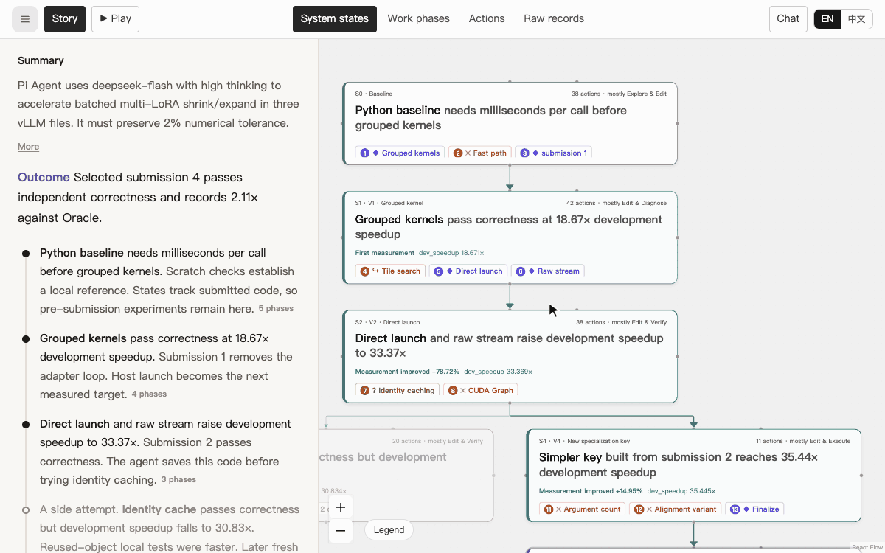
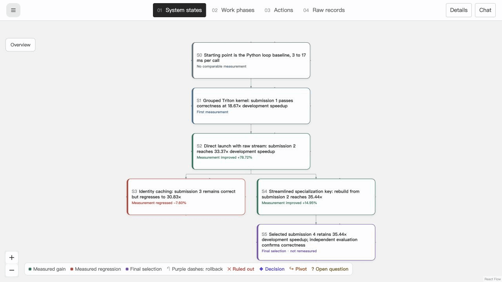
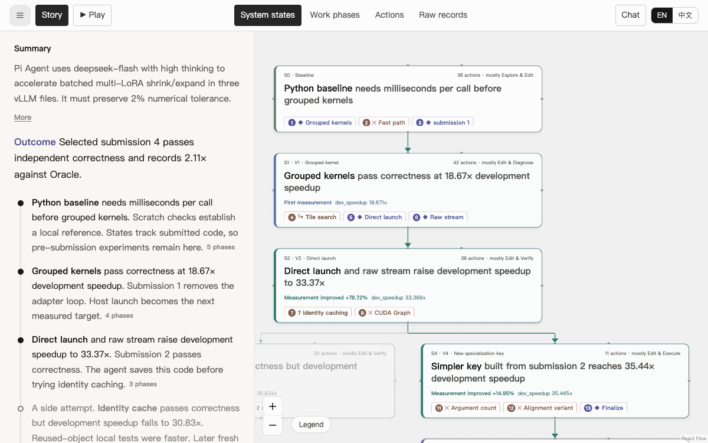
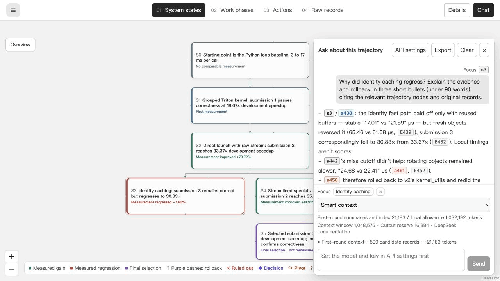

<div align="center">

# TraceVista

**See how coding agents solve problems.**

Turn agent logs into an interactive map of states, decisions, and evidence.<br/>
Zoom out to follow the story. Zoom in to read the original work. Ask questions along the way.

[**Open TraceVista**](https://tracevista.pages.dev/) · [**Explore examples**](#explore-real-agent-runs) · [**Convert your trajectory**](#bring-your-own-trajectory) · [Docs](docs/VIEWER.md)

</div>

## One run. Four levels of detail.

A coding session can contain hundreds of messages, edits, and tool calls. TraceVista gives that work a structure you can explore:

**System states → Work phases → Actions → Raw records**

| Level | What you see |
|---|---|
| **System states** | How code and artifacts evolved, where results improved or regressed, and which version was selected. |
| **Work phases** | The approaches an agent explored, the alternatives it tried, and where it changed direction. |
| **Actions** | Explore, Plan, Edit, Execute, Verify, and Diagnose—with descriptions, outcomes, and who did the work. |
| **Raw records** | Original messages, recorded reasoning, tool inputs and outputs, and reviewer feedback. |

Start with **Hierarchy view**: expand a state to read its work phases, then actions and raw records, while keeping the surrounding work visible. Each card opens independently and remembers its expanded children when collapsed. **Run overview** starts open with the task and configuration.

Open **Details** for descriptions, version origins, measurements, and evidence. Switch to **Map view** to pan and zoom through the same run, or jump between levels with the toolbar. Reference links open the target's path in the hierarchy. Nesting shows containment; version ancestry and execution order remain separate relations.

[](https://tracevista.pages.dev/?example=pi-agent-lora)

## Follow the decisions

See what the agent tried, what it learned, and what happened next. Decision markers highlight discoveries, rejected ideas, pivots, and open questions. **Decisions only** folds routine steps so the important turns stand out.

Switch between **Version tree** and **Execution order** to follow both code ancestry and the sequence of work. Restored versions, abandoned candidates, and final selections stay visible. Measurements sit alongside the states they describe.

[](https://tracevista.pages.dev/?example=pi-agent-lora)

## Go straight to the evidence

Open a card's details, then read the original messages, code, tool calls, and results behind it. Follow the agent's explanation all the way to the recorded work.

[](https://tracevista.pages.dev/?example=pi-agent-lora)

Bring the main agent and its reviewers into one map. Follow a review request through feedback, revisions, and another round of checks. Inspect skill use, knowledge reuse, TODOs, and measurements in **Structure & evidence**.

## Chat with your trajectory

Select a node, open **Chat**, and ask about that step or the run around it:

> Why did the agent abandon this approach? What evidence led to the next version?

**Smart context** first reads node summaries and an index of the raw records, then selects the records to read in full. Answers include clickable citations that take you back to the relevant nodes and events.

[](https://tracevista.pages.dev/?example=pi-agent-lora)

Connect Claude, OpenAI, Gemini, DeepSeek, Kimi, GLM, Qwen, MiniMax, OpenRouter, or your own compatible endpoint. Local models work through Ollama and LM Studio.

## Explore real agent runs

Open an example and follow its decisions from the overview down to the original records.

| Example | Inside the run |
|---|---|
| [**Pi Agent · Kernel Optimization**](https://tracevista.pages.dev/?example=pi-agent-lora) | DeepSeek Flash optimizes vLLM's multi-LoRA kernels on an A100. Follow grouped Triton kernels, direct launch, an identity-cache regression, and a return to an earlier candidate. |
| [**Claude Code · Post Training**](https://tracevista.pages.dev/?example=posttrainbench-fable5-aime) | Fable 5 Max trains Qwen3-4B for AIME 2025 on an H100. Explore fine-tuning, checkpoint averaging, evaluation, and the choice of the final model. |
| [**Codex · Model Serving**](https://tracevista.pages.dev/?example=inferencebench-serving-recovery) | GPT-5.5 High tunes a Mistral-7B server on an H100. Follow scheduler experiments, startup recovery, and a rejected sampling change. |
| [**OpenHands · Bug Fixing**](https://tracevista.pages.dev/?example=swe-rebench-kafka-retry) | Qwen3-Coder investigates a Kafka connection retry loop. Trace source edits, revised tests, and the gap between local checks and the benchmark outcome. |
| [**Tongyi DeepResearch · Literature Research**](https://tracevista.pages.dev/?example=literesearcher-affiliations) | A teacher trajectory from LiteResearcher SFT data compares two journal articles to identify the authors’ shared institution. Follow an empty PDF, a switch to journal author blocks, and a broader search after zero results. |

## Bring your own trajectory

**Two prompts. A complete map.** Copy these into your coding agent.

### 1. Install the skill

```text
Install skills/tracevista-skill from https://github.com/Superone77/trajactory_visualizer
```

### 2. Convert and open

```text
Use tracevista-skill to convert [trajectory file or folder] into a complete .agent-state.json,
then open https://tracevista.pages.dev/ in my browser and import it.
```

Use `$tracevista-skill` in Codex or `/tracevista-skill` in Claude Code. The skill reads the logs, builds the state map and summaries, validates the export, and opens it in the viewer. You can ask the agent to refine the same map as you explore.

Works with **Claude Code, Codex, and Pi** session logs, **InferenceBench** traces, and **SWE-rebench OpenHands** trajectories. Combine main-agent and reviewer sessions in a single export.

The map, annotations, original records, and source attachments travel together in one `.agent-state.json`. Reopen it with **Import trajectory**, send it to a collaborator, or keep refining it with your agent. The conversion scripts use Python 3.10+ and its standard library.

[Skill guide](skills/tracevista-skill/SKILL.md) · [Conversion workflow](skills/tracevista-skill/references/conversion.md) · [Multiple agents](skills/tracevista-skill/references/multi-agent.md)

## Run locally

Requires **Node.js 24.x** and **pnpm 11.19.0**.

```bash
git clone https://github.com/Superone77/trajactory_visualizer.git
cd trajactory_visualizer
npm install -g pnpm@11.19.0
pnpm install --frozen-lockfile --ignore-scripts
pnpm dev
```

Open [localhost:8875](http://127.0.0.1:8875/). Run `pnpm build` to produce a static site in `dist/`, ready for Cloudflare Pages or another static host. Run `pnpm test` to check the viewer, skill, and bundled examples.

## Build on TraceVista

TraceVista pairs a **React Flow viewer** with a **trajectory conversion skill**. A shared JSON format connects them, so new agents and tasks can bring their own adapters, annotations, and examples.

- [Viewer guide](docs/VIEWER.md) — navigation, details, chat, and model connections.
- [State graph format](skills/tracevista-skill/references/state-graph.md) — states, actions, transitions, and evidence.
- [Reading layer](skills/tracevista-skill/references/reading-layer.md) — summaries, turning points, and decision links.
- [Contributing](docs/BRANCHES.md) — work on a branch and send a pull request.

Have an interesting trajectory or an idea for the viewer? [Open an issue](https://github.com/Superone77/trajactory_visualizer/issues).

## Acknowledgements

TraceVista builds on ideas and code from [ThoughtDAG](https://github.com/chenxiachan/thoughtdag), including its semantic zoom, reading layer, and model connections. The viewer uses [React Flow](https://reactflow.dev/).

Thanks to the teams behind PostTrainBench, InferenceBench, SWE-rebench, and LiteResearcher for publishing agent trajectories. [Sources and attribution](THIRD_PARTY_NOTICES.md).
