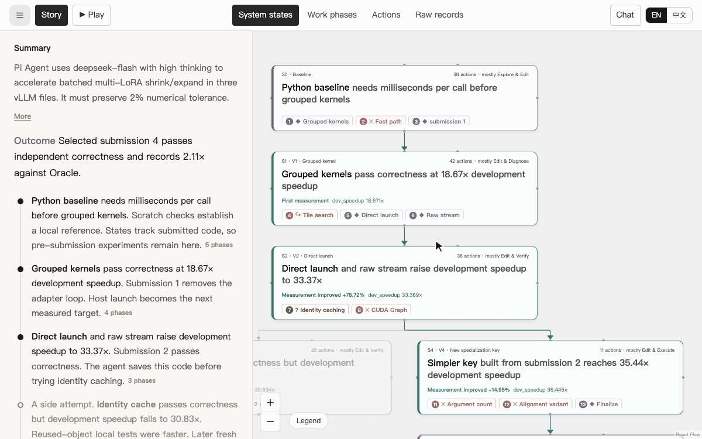
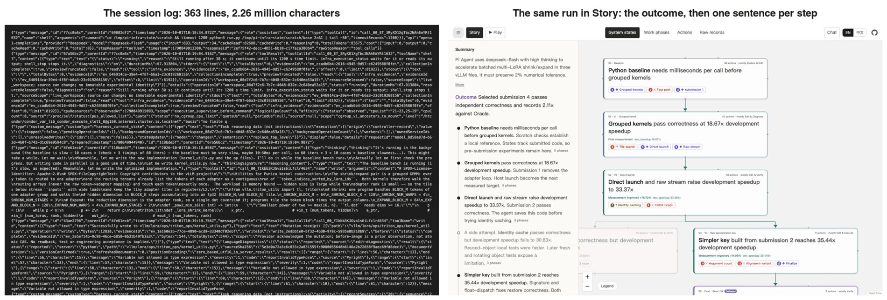
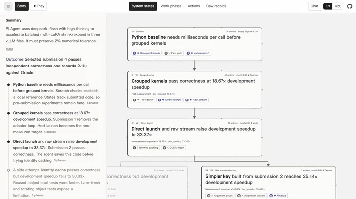
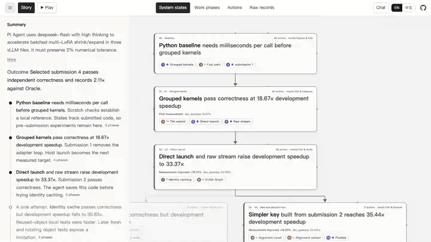
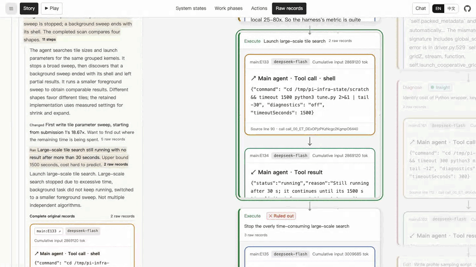

<div align="center">

# TraceVista

**看懂你的 Agent。**

看懂复杂的 agent 轨迹。<br/>
先看全貌，再展开细节，遇到疑点就核对原始证据。

适用于编程、研究和创作类任务。

[](LICENSE)
[](https://github.com/Superone77/TraceVista/actions/workflows/verify.yml)
[](https://tracevista.pages.dev/)

[**打开 TraceVista**](https://tracevista.pages.dev/) · [**浏览示例**](#浏览真实的-agent-运行) · [**转换你的轨迹**](#导入你自己的轨迹) · [文档](docs/VIEWER.zh-CN.md)

[English](README.md) · **简体中文**

</div>

https://github.com/user-attachments/assets/2a7f474b-ba02-4f01-85b6-4652edecaf76

## 别让 agent 的工作变成认知债务

**在 AI 时代，认知债务可能比技术债务更危险。**

agent 跑了一整夜，任务完成，你准备交付。但它的推理记录、工具调用、代码修改和输出散落在几千条日志里。

Andrej Karpathy 提出，我们会花更多时间理解模型的输出。但在交付压力下，我们很难抽出足够的时间，弄清 agent 做过什么，以及它留下的代码：

- agent 探索过哪些方案？
- 它为什么放弃某个方向？
- 最终版本有哪些证据支持？

这些没有得到回答的问题不断积累，变成**认知债务**，让项目越来越难审查、修改和维护。

**这就是我们做 TraceVista 的原因。** 先看全貌，再展开细节，遇到说不通的地方，就回到证据里核对。

- 🗺️ [**看清决策地图。**](#看清决策地图) 追踪探索过的方案、失败、转向和版本历史。
- 🔍 [**逐层展开细节。**](#逐层展开细节) 从系统状态深入到工作阶段、动作和原始记录，再返回上层，保留阅读位置。
- 💬 [**结合上下文提问。**](#结合上下文提问) 围绕一个节点提问，沿着回答中的引用回到证据。
- 📄 [**核对原始记录。**](#核对原始记录) 把摘要和它背后的原始记录放在一起看。

理解 agent 的工作，不应该只能依赖另一份 AI 生成的摘要。

TraceVista 已开源。欢迎[探索真实会话](https://tracevista.pages.dev/#examples)、[导入自己的轨迹](#导入你自己的轨迹)，并[告诉我们还有什么难以理解](https://github.com/Superone77/TraceVista/issues)。

## 浏览真实的 agent 运行

打开一个示例，从总览一路看到原始记录。无需注册，也不需要模型 key。

| 示例 | 运行内容 |
|---|---|
| [**Pi Agent · 内核优化**](https://tracevista.pages.dev/?example=pi-agent-lora) | DeepSeek Flash 在 A100 上优化 vLLM 的 multi-LoRA 内核。可以看到分组 Triton 内核、直接启动、一次 identity cache 导致的性能回退，以及最后退回到更早的候选版本。 |
| [**Claude Code · 后训练**](https://tracevista.pages.dev/?example=posttrainbench-fable5-aime) | Fable 5 Max 在 H100 上为 AIME 2025 训练 Qwen3-4B。包括微调、checkpoint 平均、评测，以及最终模型的选择。 |
| [**Codex · 模型服务**](https://tracevista.pages.dev/?example=inferencebench-serving-recovery) | GPT-5.5 High 在 H100 上调优 Mistral-7B 推理服务。包括调度器实验、启动故障恢复，以及一次被否决的采样改动。 |
| [**OpenHands · 修 Bug**](https://tracevista.pages.dev/?example=swe-rebench-kafka-retry) | Qwen3-Coder 排查 Kafka 连接重试循环。可以追踪源码修改、测试调整，以及本地检查通过但 benchmark 未通过之间的差距。 |
| [**Tongyi DeepResearch · 文献调研**](https://tracevista.pages.dev/?example=literesearcher-affiliations) | 来自 LiteResearcher SFT 数据的教师轨迹：比较两篇期刊论文，找出作者共同所属的机构。可以看到 PDF 读取为空、改读期刊作者信息，以及搜索无结果后扩大范围。 |
| [**Codex · 花园动画**](https://tracevista.pages.dev/?example=codex-garden-animation) | GPT-6 Astra 用 Three.js 把一座残破古厅堂改成花草覆盖、随风摇曳的花园。可以看到截图检查、录制超时后换一条保存路径，以及对 10 秒 MP4 的最终检查。这是一段较长会话的节选。 |

## 导入你自己的轨迹

**两条提示词，一张完整地图。** 把下面的内容复制给你的 coding agent。

### 1. 安装 skill

```text
从 https://github.com/Superone77/TraceVista 安装 skills/tracevista-skill
```

也可以通过 agent 的插件入口安装：[安装指南](docs/AGENT-INTEGRATIONS.md)包含
Claude Code、Codex、Cursor、Gemini CLI、OpenCode 和 Pi。
[DeepSeek Harness 插件](integrations/deepseek-harness/README.md)支持从会话中发起转换。

### 2. 转换并打开

```text
用 tracevista-skill 把 [轨迹文件或文件夹] 转换成完整的 .agent-state.json，
然后在浏览器中打开 https://tracevista.pages.dev/ 并导入它。
```

在 Codex 中用 `$tracevista-skill`，在 Claude Code 中用 `/tracevista-skill`（通过插件安装时用 `/tracevista:tracevista-skill`）。skill 会读取日志、构建状态地图和摘要、校验导出文件，再在查看器中打开。浏览过程中，你可以继续让 agent 修改同一张地图。

它的[写作指南](skills/tracevista-skill/references/clear-writing.md)借鉴了 ASD-STE100：用具体的动词、统一的术语，一句话只讲一件事。每段解释都把 agent 做了什么、证据显示了什么、它接下来选择了什么串起来，并保留完整的技术条件。

支持 **Claude Code、Codex 和 Pi** 的会话日志、**InferenceBench** 轨迹和 **SWE-rebench OpenHands** 轨迹。主 agent 和 reviewer 的会话可以合并到同一个导出文件里。

地图、注释、原始记录和附件都保存在同一个 `.agent-state.json` 中。可以用 **导入轨迹** 重新打开，发给合作者，或者交给 agent 继续完善。转换脚本只需要 Python 3.10+ 和标准库。

[Skill 指南](skills/tracevista-skill/SKILL.md) · [转换流程](skills/tracevista-skill/references/conversion.md) · [多 agent](skills/tracevista-skill/references/multi-agent.md)

## 看清决策地图

看 agent 尝试了什么、发现了什么、接下来做了什么。决策标记会标出新发现、被否决的想法、方向转变和悬而未决的问题。**只看决策** 会折叠常规步骤，让关键转折更突出。

在 **版本树** 和 **执行顺序** 之间切换，既能看代码的继承关系，也能看工作的先后顺序。恢复的版本、放弃的候选和最终选择都会保留在图上。测量结果显示在对应的状态旁边。

按 **播放** 进入导览：故事线展开当前步骤，地图同步移动到相同位置。你可以暂停、前进、后退、调整速度，或者打开原始证据。退出后会回到之前的视图。

[](https://tracevista.pages.dev/?example=pi-agent-lora)

## 逐层展开细节

同一次运行可以在四个相互关联的层级上查看：

**系统状态 → 工作阶段 → 动作 → 原始记录**

| 层级 | 你能看到什么 |
|---|---|
| **系统状态** | 代码和产物如何演变，结果在哪里变好或变差，最终选了哪个版本。 |
| **工作阶段** | agent 探索过哪些思路，尝试了哪些替代方案，在哪里改变了方向。 |
| **动作** | 探索、规划、编辑、执行、验证和诊断，附带描述、结果和执行者。 |
| **原始记录** | 原始消息、记录下来的推理过程、工具的输入输出，以及 reviewer 的反馈。 |

在同一张画布上平移和缩放，或者用工具栏在层级间跳转。选中任意卡片，会在 **故事线** 中展开它所在的路径，并可以继续追溯证据。

[](https://tracevista.pages.dev/?example=pi-agent-lora)

## 结合上下文提问

选中一个节点，打开 **对话**，就这一步或它周围的过程提问：

> agent 为什么放弃了这个方案？是什么证据促成了下一个版本？

**智能上下文** 会先读节点摘要和原始记录的索引，再挑出需要完整阅读的记录。回答中的引用可以点击，直接跳回相关的节点和事件。

问一个决策是怎么发生的，会得到带链接的流程图；也可以让它用表格比较几次尝试。点击回答中的结论或证据，就能在故事线和地图中定位到它。回答会区分记录下来的事实、推断和尚未解决的问题。

[](https://tracevista.pages.dev/?example=pi-agent-lora)

支持连接 Claude、OpenAI、Gemini、DeepSeek、Kimi、GLM、Qwen、MiniMax、OpenRouter，或你自己的兼容接口。本地模型可以通过 Ollama 和 LM Studio 使用。

## 核对原始记录

在 **故事线** 中展开一张卡片，就能读到它背后的原始消息、代码、工具调用和结果。原始记录始终可以在摘要旁查看，你可以对照来源核查解释，自己判断发生了什么。

[](https://tracevista.pages.dev/?example=pi-agent-lora)

主 agent 和 reviewer 可以放进同一张地图。你可以跟着一次评审请求，看反馈、修改和下一轮检查。在 **结构与证据** 中可以查看 skill 使用、知识复用、TODO 和测量结果。

## 为知情决策而设计

<details>
<summary>有了 TraceVista，<strong>不必读完整份日志</strong>，你也能判断一次 agent 运行是否可信、哪些步骤值得核查。</summary>

一次 agent 运行留下的文字，往往多到没人读得完。[Pi Agent 示例](https://tracevista.pages.dev/?example=pi-agent-lora)运行了约 45 分钟，留下 556 条事件和一份 226 万字符的会话日志。



</details>

<details>
<summary>TraceVista 把会话日志整理成故事线，<strong>开头先写这次运行交付了什么</strong>。</summary>

之后用一句话讲一步。Segel 和 Heer（2010）把这种结构叫作**马提尼杯**。开头由作者带读，走过窄窄的杯柄；之后由读者自己探索宽阔的杯口，在这里就是地图、原始记录和对话。▶ 播放会逐句走完故事线，地图同步移动。

[](https://tracevista.pages.dev/?example=pi-agent-lora)

</details>

<details>
<summary>TraceVista 让<strong>每一句话都能在原处展开</strong>。</summary>

点一句话，它的工作阶段在下方展开；点一个阶段，展开其中的动作；点一个动作，展开原始记录。Ted Nelson 把这种写法叫作 **StretchText**（1967）。故事线的其余部分保持原位，地图同步切换到同一层级。

[](https://tracevista.pages.dev/?example=pi-agent-lora)

</details>

<details>
<summary>TraceVista <strong>逐字保留 agent 自己的记录</strong>，你可以展开摘要，核对它的来源。</summary>

这些记录不做翻译。模型写的摘要往往比原文说得更肯定。我们核对 [TextFold](https://github.com/chenxiachan/textfold) 的论文摘要时，发现有一处把 potentially harmful（可能有害）写成了 harmful（有害）。原始记录随时可查，读者就能按证据调整自己的信任（Lee & See, 2004）。

[](https://tracevista.pages.dev/?example=pi-agent-lora)

</details>

## 本地运行

需要 **Node.js 24 或更新版本**、**pnpm 11 或更新版本**。CI 检查 Node.js 24 和最新版本；`.nvmrc` 提供 Node.js 24 作为默认选择。

```bash
git clone --depth 1 --branch main https://github.com/Superone77/TraceVista.git
cd TraceVista
npm install -g pnpm@11
pnpm install --frozen-lockfile --ignore-scripts
pnpm dev
```

打开 [localhost:8875](http://127.0.0.1:8875/)，导入 `.agent-state.json`。默认的查看器、构建和测试都无需示例库。

浅克隆只下载最新的 `main` 快照。独立查看器和官网共用本仓库的引擎与界面代码；官网构建时加入单独管理版本的案例数据。

| 命令 | 用途 |
|---|---|
| `pnpm dev` | 启动独立查看器。 |
| `pnpm test` | 用小型测试数据检查查看器和转换 skill。 |
| `pnpm build` | 将独立查看器构建到 `dist/`。 |
| `pnpm dev:site` | 加载锁定版本的外部示例库，启动展示站。 |
| `pnpm test:examples` | 检查完整示例导出及其来源证据。 |
| `pnpm build:site` | 将展示站构建到 `dist-site/`。 |

六个案例可以直接在[网站](https://tracevista.pages.dev/)浏览。本地运行展示站时，把独立的 `TraceVista-examples` 仓库放在当前仓库旁边，或设置 `TRACEVISTA_EXAMPLES_DIR`。查看器通过 `examples.lock.json` 固定数据提交和文件哈希。获取数据、验证和发布方法见[示例库说明](docs/EXAMPLES.md)。两种构建产物都可以部署到静态托管服务。

## 基于 TraceVista 开发

TraceVista 由一个 **React Flow 查看器** 和一个 **轨迹转换 skill** 组成，两者通过共享的 JSON 格式连接。新的 agent 和任务可以带上自己的适配器、注释和示例。

- [查看器指南](docs/VIEWER.zh-CN.md)：地图、Story、播放、对话和模型连接。
- [状态图格式](skills/tracevista-skill/references/state-graph.md)：状态、动作、转换和证据。
- [阅读层](skills/tracevista-skill/references/reading-layer.md)：摘要、转折点和决策关联。
- [贡献指南](CONTRIBUTING.md)：环境搭建、运行检查、新增适配器或示例、提交 pull request。

有有趣的轨迹，或者对查看器有想法？欢迎[提 issue](https://github.com/Superone77/TraceVista/issues)。

## 引用

如果你在工作中使用了 TraceVista，欢迎引用：

```bibtex
@misc{yang2026tracevista,
  author = {Wanqi Yang and Xia Chen and Qilong Huang and Mei Xie and André Borrmann and Shiwei Liu},
  title = {{TraceVista}: Understanding Agent Trajectories through Hierarchical Exploration},
  year = {2026},
  howpublished = {\url{https://github.com/Superone77/TraceVista}}
}
```

## 许可证

TraceVista 的代码以 [MIT 许可证](LICENSE) 发布。外部示例库沿用各自来源的许可证，例如 Apache-2.0 和 CC-BY-4.0，并保留独立的来源声明。代码署名与示例声明的位置见 [THIRD_PARTY_NOTICES.md](THIRD_PARTY_NOTICES.md)。

## 致谢

TraceVista 借鉴了 [ThoughtDAG](https://github.com/chenxiachan/thoughtdag) 的思路和代码，包括语义缩放、阅读层和模型连接。查看器基于 [React Flow](https://reactflow.dev/)。

感谢 PostTrainBench、InferenceBench、SWE-rebench 和 LiteResearcher 团队公开 agent 轨迹。[来源与署名](THIRD_PARTY_NOTICES.md)。
